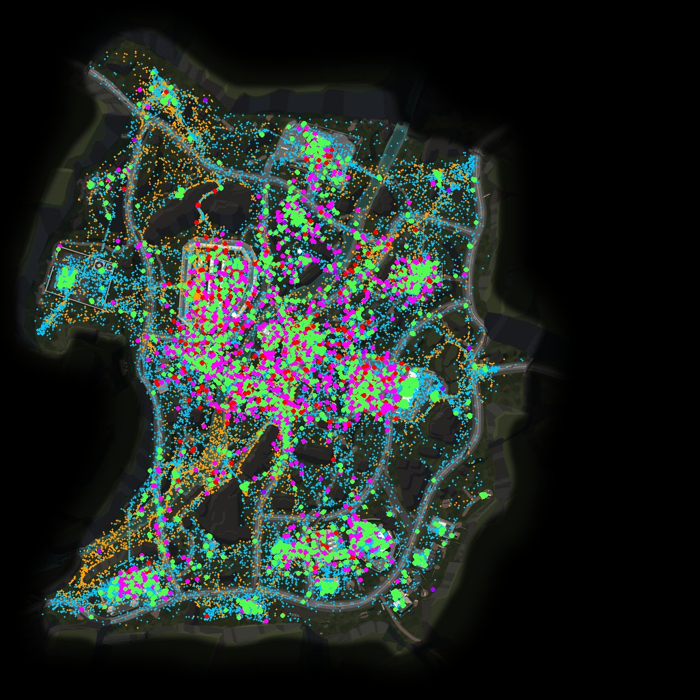
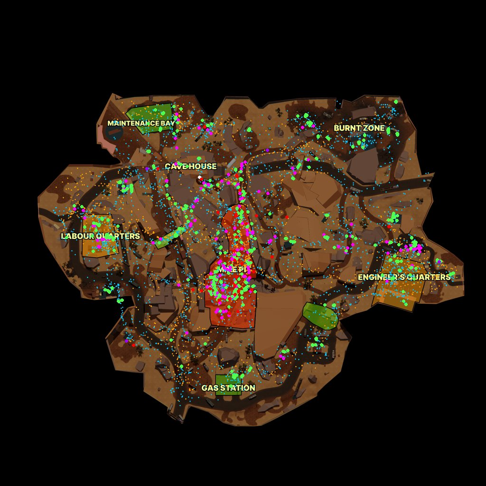
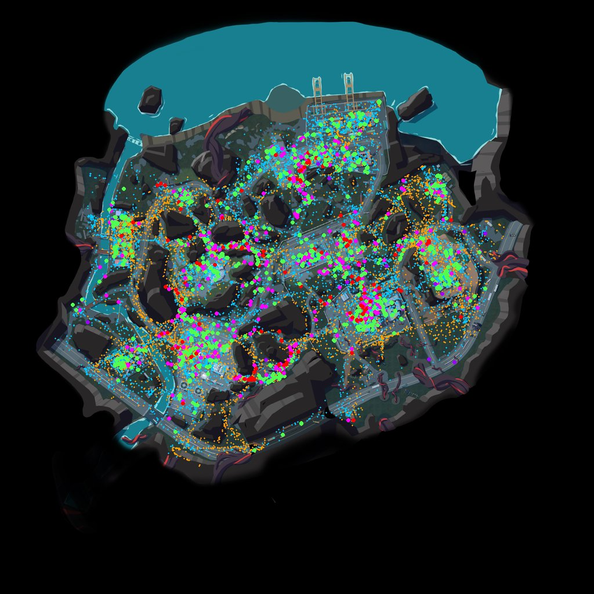

# Architecture

## What I built with and why

**Python pre-processing → static JSON → React + Canvas, hosted on Vercel.**

The whole dataset is 89k rows (about 8 MB of parquet). That's small enough to clean once offline and ship to the browser in full, which makes every interaction (filter, scrub, heatmap) instant and leaves nothing on a server to break. Python handles the parquet and the data cleaning, where correctness matters most and is easy to test. React handles the UI state. The map itself is drawn on a single `<canvas>`, because SVG/DOM would choke on about 1,200 paths and 16k markers redrawn every frame of playback.

## Data flow

```
player_data/February_*/<user>_<match>.nakama-0   (1,243 parquet files)
        │  pipeline/build_data.py
        │   1. read every file, decode `event` bytes → str
        │   2. ts → epoch seconds; bot = numeric user_id
        │   3. drop exact duplicates (keep ×count), stable-sort by (t, file row)
        │   4. trim each journey at its first death
        │   5. world (x,z) → image UV, quantised to ints 0..10000
        │   6. group by match_id; per-match start/duration/humans/bots/event counts
        ▼
web/public/data/manifest.json + <Map>.json (1.2 MB / 0.4 MB / 0.1 MB raw, ~40% of that gzipped) + minimaps/*.webp
        │  fetched lazily per map, decoded once into typed arrays (src/lib/data.ts)
        ▼
select(filters) → journeys + events        (src/lib/filters.ts)
        ├─ MapCanvas: image → heatmap → paths (≤ t) → markers (≤ t) → live heads
        ├─ buildHeatmap: 160² grid → separable Gaussian blur → sqrt colour ramp
        └─ Timeline: rAF playback; combat-density strip
```

Every filter is kept in the URL hash, so any view can be shared as a link.

## Coordinate mapping

The README gives `u = (x − originX)/scale`, `v = (z − originZ)/scale`, `pixel = (u·1024, (1 − v)·1024)`. `y` is elevation and is ignored. Two things needed care:

1. **The images aren't 1024².** They're 4320², 2160×2158 and 9000². So the pipeline stops at UV: it stores `(u, 1 − v)` with a top-left origin, and the frontend multiplies by whatever image it actually renders (2048 px WebP). The flip lives in one function, `world_to_uv`, and is unit-tested against the README's worked example (→ pixel 78, 890).
2. **Verifying it, rather than trusting it.** `pipeline/verify_overlay.py` plots every raw event straight from parquet onto each minimap. On all three maps, paths follow roads and corridors, the GrandRift clusters sit on the named zones, nothing lands in Lockdown's sea, and 0 of 89,104 points fall outside [0,1]. An axis swap or a missing flip would be obvious immediately.

| Ambrose Valley | Grand Rift | Lockdown |
|---|---|---|
|  |  |  |

## Assumptions (where the data was ambiguous)

| Ambiguity | What I found | Decision |
|---|---|---|
| `ts` units | README says ms of match time. That gives matches under 1 s. As epoch seconds it matches the day folders and gives 2–15 min matches | Treat as epoch seconds. Match time = t − first event of the match. 1 s resolution, so ties keep file order |
| Date of a match | Folders roughly follow UTC days but include matches that started minutes before midnight. 1 match spans two folders | Date = the folder most of the match's rows came from |
| Who is a bot | 94 numeric IDs, but some log `Position`/`Loot` like humans | Numeric `user_id` ⇒ bot, regardless of event names |
| `BotKill`/`BotKilled` in bot files | The "Bot" prefix names the opponent. Kills and deaths are logged one-sided, and a human's kills don't match any recorded bot death | Interpret from the file owner's view: bot-file `BotKill` = killed another bot |
| Where a kill is drawn | Rows only carry the logger's position | Kill markers = killer position, death markers = victim position |
| Duplicates | 1,505 identical rows, mostly loot | Collapse to one marker with a ×N count. Loot totals use N |
| Events after death | 173 positions + 2 kills after a journey's first death | Drop them; the first death ends the journey |
| Sparse matches | 93% of matches have one journey | Treat as a sample, not full lobbies. Sort busy matches first; "All matches" overlays everything aligned at t = 0 |
| Paths between samples | Sampled every ~5 s | Straight-line interpolation (also used for smooth playback heads) |

## Trade-offs

| Considered | Chose | Why |
|---|---|---|
| Streamlit / Dash | React + Canvas | The audience is Level Designers, not analysts. Smooth playback, pan/zoom and hover need a real frontend |
| DuckDB-WASM / parquet in the browser | Pre-built JSON | 1.7 MB of JSON loads faster than a 5 MB WASM runtime. Cleaning happens once, in tested Python |
| API server + DB | Static files on a CDN | Nothing to scale or keep alive. The trade-off is that new data needs a rebuild (12 s) and a redeploy |
| Pre-computed heatmap tiles | Computed in the browser | 160² grid + blur takes a few ms, so heatmaps follow every filter *and* the timeline |
| deck.gl / Leaflet | Plain Canvas 2D | The data needs one image, one transform and simple marks. It's fewer dependencies and I control every pixel |
| One file per match (796 requests) | One file per map | ≤ 1.2 MB per map, cached after the first load. Switching matches is instant |
| Full-resolution minimaps (up to 12 MB) | 2048 px WebP (~180 KB) | It's sharp up to about 2× zoom; beyond that, the detail isn't needed for this data's 5 s sampling |
