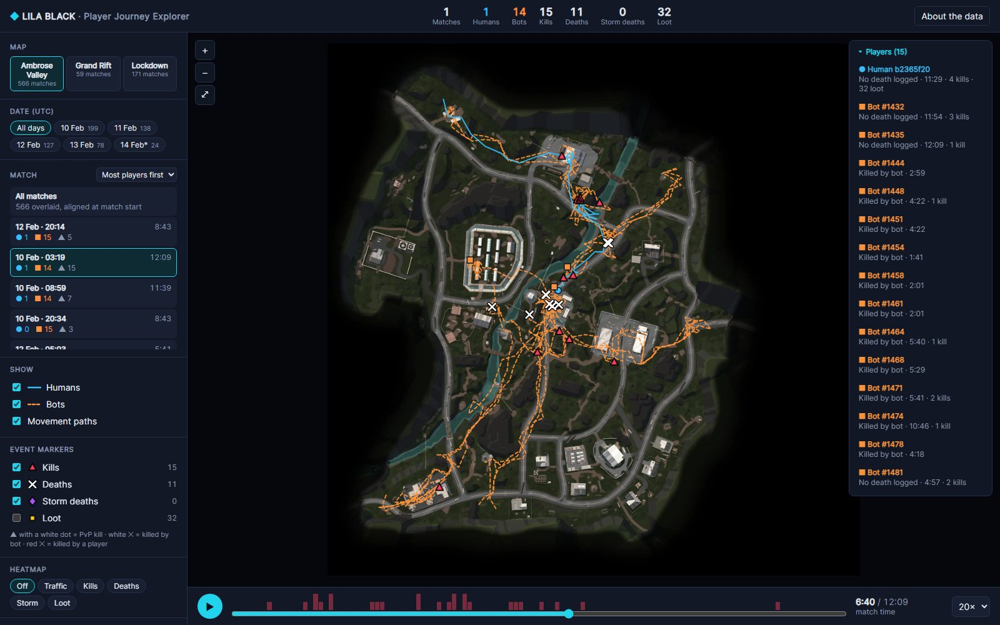
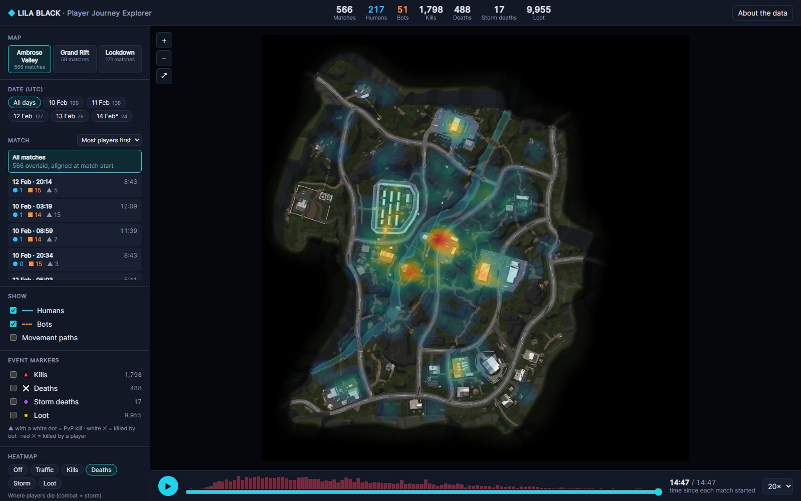
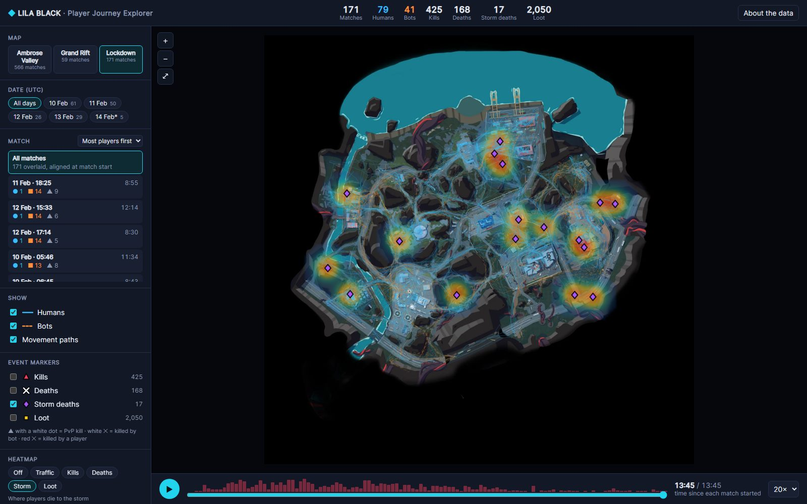
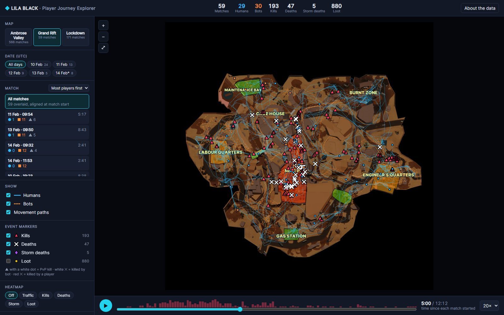

# LILA BLACK · Player Journey Explorer

[](https://github.com/anuj-chouhan/lila-player-journey-visualizer/actions/workflows/ci.yml)

A browser tool for Level Designers to see how players actually move, fight, loot and die on LILA BLACK's maps, built from 5 days of production telemetry.

**Live:** https://lila-journeys.vercel.app &nbsp;·&nbsp; **Docs:** [ARCHITECTURE.md](ARCHITECTURE.md) · [INSIGHTS.md](INSIGHTS.md) &nbsp;·&nbsp; **Walkthrough:** [step by step below](#walkthrough-5-minutes) · video: _link coming_

[](https://lila-journeys.vercel.app/#map=AmbroseValley&match=b971c686-07f6-4378-ad00-71b0b610414e&t=400)

| Deaths heatmap, all 566 Ambrose Valley matches | Storm deaths on Lockdown | All Grand Rift matches, 5 min in |
|---|---|---|
| [](https://lila-journeys.vercel.app/#map=AmbroseValley&paths=0&markers=none&heat=deaths) | [](https://lila-journeys.vercel.app/#map=Lockdown&markers=storm&heat=storm) | [](https://lila-journeys.vercel.app/#map=GrandRift&t=300) |

Each screenshot links to that exact view in the live tool.

## What it does

| Feature | How |
|---|---|
| Player journeys on the correct minimap | World `(x, z)` → minimap pixels, verified against all 89k events ([proof](ARCHITECTURE.md#coordinate-mapping)) |
| Humans vs bots | Humans: solid blue paths, ● heads. Bots: dashed orange paths, ■ heads |
| Event markers | ▲ kill (white dot = PvP), ✕ death (red = killed by player), ◆ storm death, ■ loot. Hover for details, click to follow that player (everyone else dims) |
| Filters | Map, day (multi-select), match (busiest first), humans/bots, each marker type |
| Timeline / playback | Play, scrub, 1–60× speed, with a combat-density strip so you can jump to the fights. In "All matches" mode every match is aligned at t = 0 |
| Heatmaps | Traffic, kills, deaths, storm deaths, loot. They respect every filter and the timeline position |
| Shareable views | Every filter, and the paused timeline position (`&t=400`), is kept in the URL. Paste a link to show a designer exactly the moment you saw |

Controls: drag to pan · scroll to zoom · double-click to reset · `Space` play/pause · `←/→` ±10 s · `Esc` clear focus.

## Walkthrough (5 minutes)

A guided tour of every major feature. Each step links to the exact view, so you can follow along without setting anything up.

1. **Open the tool** → [lila-journeys.vercel.app](https://lila-journeys.vercel.app). You land on Ambrose Valley with **All matches** selected: all 566 matches are overlaid, each starting at its own t = 0. The header shows the totals for the current selection, and the left sidebar holds every filter.
2. **Check the map mapping.** Scroll to zoom and drag to pan. Paths follow the roads and stay inside walls, and nothing falls off the map. Double-click to reset the view. Humans are **solid blue**, bots are **dashed orange**.
3. **Filter.** Click **Grand Rift** or **Lockdown** to switch maps. Click a **day** (you can pick several; Feb 14* is a partial day). Untick **Bots** or **Humans** to isolate one side. The header totals and the marker counts in the sidebar update as you go.
4. **Pick a match.** The list shows the busiest matches first, because 93% of matches have only one recorded player. Open the [10 Feb · 03:19 match](https://lila-journeys.vercel.app/#map=AmbroseValley&match=b971c686-07f6-4378-ad00-71b0b610414e): 1 human, 14 bots and 15 kills. The **Players** panel lists everyone in it, with how and when their run ended.
5. **Play it back.** Press **▶** (or `Space`) at 20×. Circles are humans and squares are bots. Markers appear as the match unfolds: **▲** kill, **✕** death, **◆** storm death, **■** loot (tick *Loot* to show it). The red bars above the scrubber show where the combat is, so click near a tall bar to jump to a fight.
6. **Inspect and follow.** Hover over any marker for details: what happened, who did it, and when. Click it, or click a name in **Players**, to follow that player. Their path stays full strength and everyone else dims. `Esc` clears the selection.
7. **Heatmaps.** Go back to **All matches** and choose a heatmap: [Deaths](https://lila-journeys.vercel.app/#map=AmbroseValley&paths=0&markers=none&heat=deaths), [Traffic](https://lila-journeys.vercel.app/#map=AmbroseValley&paths=0&markers=none&heat=traffic), Kills, Storm or Loot. Heatmaps follow every filter *and* the timeline, so press **▶** to watch the hotspots build up over a match.
8. **Storm deaths.** Open [Lockdown's storm view](https://lila-journeys.vercel.app/#map=Lockdown&markers=storm&heat=storm) and drag the scrubber from 0. Nothing appears until about 11 minutes, which is the basis for [insight 2](INSIGHTS.md#2-the-storm-is-a-late-match-timer-and-it-kills-over-a-third-of-late-players-on-lockdown-and-grand-rift).
9. **Share a moment.** Pause anywhere and copy the URL. It keeps the map, filters, match and time (e.g. `&t=400`), so whoever opens it sees exactly what you saw.
10. **About the data.** The **About the data** button explains what the data does and doesn't contain, and lists the keyboard shortcuts. The [data gotchas](#data-gotchas-we-caught) below cover what the dataset's README got wrong and how the tool handles it.

## Data gotchas we caught

The dataset's README is wrong or silent on a few points. Each one would have broken the tool if taken at face value:

| README says | Data actually shows | Evidence | Handling |
|---|---|---|---|
| `ts` = milliseconds elapsed in the match | `ts` holds **Unix epoch seconds** in a `timestamp[ms]` column | Read as ms, every match lasts < 1 s. Read as seconds, dates line up with the `February_10…14` folders, matches last 2–15 min, and positions are sampled every 5 s | Raw integer used as seconds. Times are made relative to each match's first event |
| Minimaps are 1024×1024 | 4320², **2160×2158**, 9000² | Image headers | Convert world → UV (0–1) and multiply by the real image size. Images re-encoded to 2048 px WebP |
| Bots emit `BotPosition`/`BotKill`/`BotKilled` | Some bot IDs also emit `Position` (636) and `Loot` (115) | Per-file event counts | Actor type comes from the `user_id` format only (numeric = bot) |
| `BotKill`/`BotKilled` = a human killed / was killed by a bot | They also appear in **bots' own files** (183 / 297), meaning that bot got a kill / died | Cross-checking files (same match, ≤ 3 s, ≤ 60 units): 44 bot kills line up with another bot's death, 25 human kills with a bot's death, 5 bot kills with the human's death. So bots kill bots as well as humans | Tooltips are worded from the file owner's side: "This bot got a kill" / "Bot died" |
| One file per player per match | 743 of 796 matches contain **one** journey. Only ~50 have 7–16 | `match_id` grouping | Match list sorts busiest first. The tool explains this in "About the data" |
| *(not mentioned)* | 1,505 exact duplicate rows (mostly loot ×2–7), 175 rows logged after the player died, 3 files not time-sorted, 1 journey split across two day folders (1,243 files → 1,242 journeys) | Pipeline cleaning report | Duplicates collapsed (shown as ×N), journeys trimmed at first death, stable sort by time, files merged by (`user_id`, `match_id`) rather than by folder |

## Tech stack

- **Data pipeline:** Python 3.11+, pyarrow, pandas, Pillow (`pipeline/`)
- **Frontend:** React 19 + TypeScript + Vite, HTML Canvas 2D (`web/`)
- **Hosting:** Vercel (static). No backend, database or environment variables.

## Run it locally

```bash
# Frontend only: the processed data is committed in web/public/data
cd web
npm ci
npm run dev            # http://localhost:5173
npm test               # unit tests + a contract test on the generated data
npm run lint
```

To regenerate the data from the raw telemetry:

```bash
# put player_data.zip's contents at data/raw/player_data/  (git-ignored)
python -m venv .venv
.venv/Scripts/activate        # Windows  (macOS/Linux: source .venv/bin/activate)
pip install -r pipeline/requirements.txt
python -m pytest pipeline     # coordinate / timestamp / bot-detection tests
python pipeline/build_data.py # writes web/public/data/*  (~12 s)
python pipeline/verify_overlay.py  # optional: regenerates docs/img/*_overlay.jpg
```

**Environment variables:** none. **Requirements:** Node 20+, Python 3.11+ (only for regenerating data).

CI (GitHub Actions) runs the pipeline tests, frontend lint, tests and production build on every push.

## Deploy

Vercel builds from `vercel.json` (install and build in `web/`, serve `web/dist`). Import the GitHub repo in Vercel and it deploys on every push. Any static host works: run `npm run build` in `web/` and upload `web/dist`.

## Repo layout

```
pipeline/           build_data.py (parquet → JSON), tests, overlay verification
web/                React app
  public/data/      generated: manifest.json, <Map>.json, minimaps/*.webp
  src/lib/          data decoding, filters, heatmap, marker drawing (no React)
  src/components/   MapCanvas, Sidebar, Timeline, PlayerList, AboutData
docs/img/           coordinate-mapping proof overlays, screenshots
.github/workflows/  CI
ARCHITECTURE.md     design, data flow, coordinate mapping, trade-offs
INSIGHTS.md         three findings from using the tool
```
